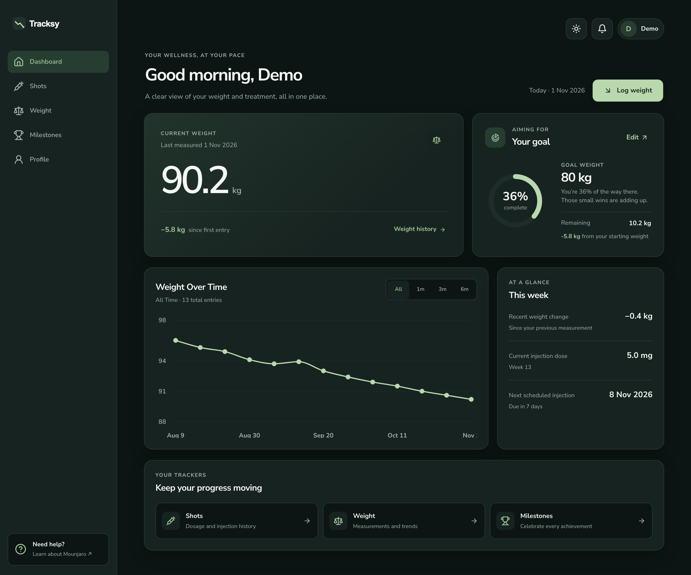
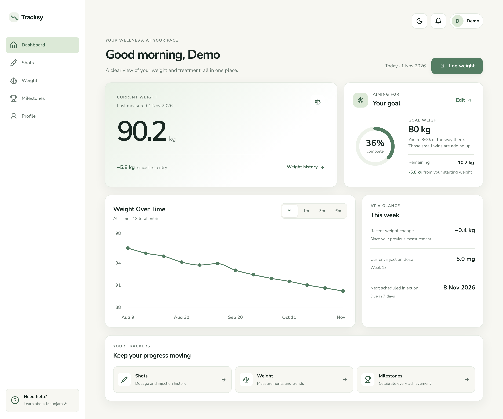
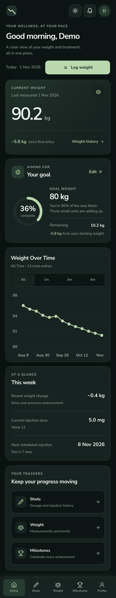
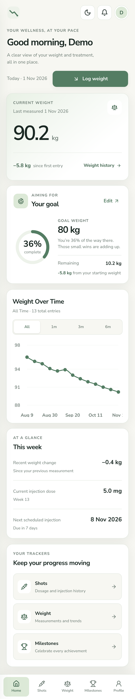

# Tracksy

**A simple, modern way to track your Mounjaro journey.**

Tracksy is an independent weight and injection tracking application designed to help you stay organized throughout your Mounjaro treatment.

Log your injections, monitor weight changes, track your dosage, and celebrate milestones — all in one place.

Built with a focus on simplicity, clarity, and meaningful progress.

---

## Features

### Injection Tracking
- Log injections with date, time, and dosage.
- Record injection sites, side effects, and optional notes.
- View your complete injection history.
- Keep track of your latest dose and next scheduled injection.

### Weight Tracking
- Record weight measurements and review your history.
- Monitor total weight change and recent trends.
- View weight progress through interactive charts.
- Switch between metric and imperial units.

### Goals & Milestones
- Set a personal target weight.
- Track progress toward your goal.
- Unlock weight-loss achievements at every 5 kg milestone.
- View your completed and upcoming achievements.

### Dashboard
- See your latest weight and overall progress.
- View your current dose and next scheduled injection.
- Explore weight trends and recent activity.
- Access your tracking features from one clear overview.

### Personal Profile
- Manage your starting weight, goal weight, and height.
- Choose your preferred measurement units.
- Keep your tracking information associated with your account.

### Responsive Experience
- Designed for desktop, tablet, and mobile.
- Supports dark and light themes.
- Progressive Web App (PWA) setup with manifest and app icons.

---

## Tech Stack

**Frontend**
- React
- TypeScript
- Vite
- TanStack Query
- React Router
- Recharts

**Backend & Infrastructure**
- AWS SST v3
- AWS Lambda
- Amazon API Gateway
- Amazon DynamoDB
- Amazon Cognito

**Deployment & Tooling**
- Vercel
- pnpm

---

## Development

### Prerequisites

- Node.js compatible with the project's configuration
- pnpm 10.28.2

### Installation

Install the pinned pnpm version directly. Corepack is not required.

```bash
npm install --global pnpm@10.28.2
pnpm install
```

### Start Development Server

```bash
pnpm run dev
```

### Project Checks

```bash
pnpm run lint
pnpm run check
pnpm run build
```

Refer to `package.json` for all available scripts.

---

## Project Conventions

Development follows the conventions documented in [`AGENTS.md`](./AGENTS.md).

Key principles include:

- Feature-based project organization.
- Strict TypeScript.
- Arrow functions and named exports.
- TanStack Query for server state.
- Tests organized in `__tests__` directories.
- Simple, readable, maintainable components.
- pnpm for dependency management.

---

## Preview





<p>
  
  
</p>

---

## Disclaimer

Tracksy is an independent tracking application and is not affiliated with, endorsed by, or sponsored by Eli Lilly and Company.

Mounjaro is a registered trademark of Eli Lilly and Company.

Tracksy is intended for personal record-keeping and progress tracking. It does not provide medical advice, treatment recommendations, or dosage guidance. Always follow instructions from your healthcare provider.

---

## About

Tracksy was created to make medication and weight tracking simpler, more organized, and easier to follow over time.

**Track your treatment. Follow your progress.**